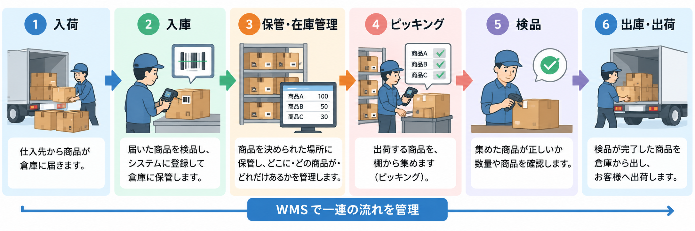

# KAKUU WMS


<div align="center">

**倉庫管理システム開発ポートフォリオ**

要求分析から設計・実装・テストまで

</div>

---

## 目次

- [制作背景](#制作背景)
- [WMSとは](#wmsとは)
- [今回想定した業務](#今回想定した業務)
- [システム化の目的](#システム化の目的)
- [システム概要](#システム概要)
- [業務フロー](#業務フロー)
- [実装機能](#実装機能)
- [使用技術](#使用技術)
- [開発方針](#開発方針)
- [開発工程・開発進捗](#開発工程開発進捗)
- [設計資料](#設計資料)
- [プロジェクト管理](#プロジェクト管理)

---

## 制作背景

### 背景

前職では、SEおよび保守・メンテナンス業務を通じて、HT（ハンディターミナル）、AGV（無人搬送車）、WMS（倉庫管理システム）など、倉庫・工場の業務を支えるさまざまなシステムに触れてきました。

これらの経験から、システム上のデータ処理だけでなく、実際の業務やモノの動きとシステムがどのように連携するのかに着目し、業務とシステムの両面を考慮したシステムを制作したいと考えました。

### 題材選定

入荷・在庫・出荷などの情報を一元的に管理するWMSは、複数の業務を関連付けながら、業務分析からシステム開発までの一連の流れを表現できると考え、本ポートフォリオの題材として選定しました。

また、倉庫業務では、現物とシステム上のデータを同期させる必要があります。

本ポートフォリオでは、取扱商品をコーヒー豆とすることで、商品とSKUの関係やロット単位の在庫管理など、倉庫管理に必要な要素を取り入れています。

### 制作で重視する点

本制作では、完成したシステムだけでなく、業務上の要求をどのようにシステムへ落とし込んだのか、その開発過程を示すことを重視します。

**要求分析 → 要件定義 → データ設計 → 外部設計 → 内部設計 → 実装 → テスト**

各工程における検討内容や設計成果物を残すことで、システム開発の一連の流れを表現します。

また、実装においては、単に動作することだけを目的とせず、可読性・保守性・将来の機能拡張を考慮した設計および実装を目指します。

## WMSとは

WMS（Warehouse Management System／倉庫管理システム）とは、商品の入荷・保管・在庫・出荷など、倉庫内の業務や情報を一元的に管理するシステムです。

商品の所在や数量、入出荷の状況を管理することで、倉庫業務の正確性や効率性の向上を支援します。



## 今回想定した業務

本ポートフォリオでは、コーヒー豆の仕入れ・卸売を行う架空の企業「株式会社KAKUU」を想定しています。

株式会社KAKUUは、国内外の仕入先からコーヒー豆を仕入れ、自社倉庫で保管・在庫管理を行い、飲食店や小売店などの卸先へ商品を出荷しています。

取扱商品は約10種類のコーヒー豆を中心とし、賞味期限やロット単位での管理が必要となる業務を想定しています。

### 現状の業務

現在は専用のWMSを導入しておらず、Excel・メール・CSVデータ・紙資料などを組み合わせて業務を行っています。

仕入先への発注、商品の入荷確認、在庫管理、ピッキング、出荷検品、発送、領収書の作成などを担当者が行っており、情報の転記や更新、実在庫との照合に手作業が多く発生しています。

### 今回のシステム化対象

KAKUU WMSでは、既存業務のすべてを置き換えるのではなく、仕入CSVの取込から入荷・入庫、在庫管理、注文CSVの取込、在庫引当、出荷検品、出荷確定までを中心とした部分導入を想定しています。

実際の商品のピッキングや搬出、配送手続きなどは引き続き人が行うものとし、システムでは業務に必要な情報の登録・確認・管理を行います。

## システム化の目的

Excelや担当者による手作業を中心とした現状の倉庫業務に対し、WMSを導入することで、業務の正確性・効率性および情報の信頼性の向上を目指します。

### 主な目的

| 目的 | 内容 |
|---|---|
| 在庫情報の一元管理 | 仕入れ・入荷・在庫・出荷に関する情報を関連付け、必要な情報を確認できるようにする。 |
| 業務効率の向上 | CSVデータの手作業による転記や、複数のExcelファイルを確認する作業を削減する。 |
| 在庫管理精度の向上 | 現物とシステム上の在庫情報の差異や、在庫の更新漏れを抑制する。 |
| ロット・賞味期限管理 | ロット単位で在庫を管理し、商品の追跡性を向上させる。 |
| 検品精度の向上 | JANコードを活用した商品照合と数量確認により、商品や数量の間違いを抑制する。 |
| 業務の標準化 | 業務手順を整理し、担当者の経験や判断への依存を軽減する。 |

### 段階的なシステム導入

既存業務のすべてを一度にシステム化するのではなく、対象業務を限定した部分導入を想定しています。

初期導入後の運用結果や課題を踏まえ、業務改善や将来的な機能拡張につなげることを目指します。

## システム概要

KAKUU WMSは、仕入れ・入荷・入庫・在庫・出荷・検品に関する業務情報を一元的に管理し、倉庫業務を支援するWebシステムです。

仕入先や卸先から受領したCSVデータを起点として、商品の入荷から出荷確定までの情報を関連付けて管理します。

また、SKU・ロット・オリコン・保管場所を関連付けることで、倉庫内の商品の所在や数量を管理します。

### 基本情報

| 項目 | 内容 |
|---|---|
| システム名 | KAKUU WMS |
| システム種別 | 倉庫管理システム（WMS） |
| システム形態 | Webシステム |
| 利用端末 | PC |
| 利用対象 | 株式会社KAKUUの社員 |
| 外部データ取込 | 仕入CSV・注文CSVの手動取込 |
| 想定利用者数 | 20人 |
| ピーク時の同時利用者数 | 10人 |

### システム利用者

| 利用者 | 主な担当業務 |
|---|---|
| 仕入れ担当者 | 仕入CSVの取込、入荷予定の管理 |
| 入荷担当者 | 入荷検品、入荷実績登録、入庫 |
| 注文受付担当者 | 注文CSVの取込、注文情報の管理 |
| 出荷担当者 | 在庫引当、出荷指示、出荷検品、出荷確定 |
| 在庫管理担当者 | 在庫・ロット情報の確認、在庫数量調整、在庫移動 |
| システム運用管理者 | 社員情報や各種マスタの管理 |

なお、同一の社員が複数の役割を兼任することを想定しています。

### 主な管理情報

| 分類 | 管理情報 |
|---|---|
| 商品情報 | 商品、SKU、商品カテゴリ |
| 取引先・社員情報 | 取引先会社、社員 |
| 倉庫情報 | ロケーション、棚・段、オリコン |
| 仕入れ・入荷情報 | 仕入れ情報、入荷予定、入荷・入庫実績 |
| 在庫情報 | 在庫数量、ロット、保管場所 |
| 注文・出荷情報 | 注文・出荷データ、引当情報、出荷指示、出荷検品結果 |
| システム管理情報 | CSV取込設定、読み取り設定、CSV取込結果 |

### システム構成図

※ システム構成図は、設計工程が完了した段階で追加予定です。

## 業務フロー

要求分析で整理したシステム導入前の業務フローをもとに、要件定義ではシステム導入後の業務フローを整理しています。

システム導入前後の業務フロー図および業務別の詳細な流れについては、以下の資料を参照してください。

**[業務フロー図（システム導入前・導入後）](docs/02_要件定義/02_業務フロー/README.md)**

## 実装機能

KAKUU WMSでは、要件定義に基づき、以下の機能を実装予定です。

### 機能一覧

| 機能区分 | 主な機能 |
|---|---|
| 共通・認証 | ログイン、ログアウト、共通メニュー、各管理メニュー |
| マスタ管理 | 商品、SKU、商品カテゴリ、会社、会社別名、社員、ロケーション、棚・段、オリコン、CSV取込設定、読み取り設定の管理 |
| 商品参照 | 商品・SKU情報の検索・参照 |
| 仕入れ管理 | 仕入CSV取込、データ検証、入荷予定登録、取込結果確認 |
| 入荷・入庫管理 | 入荷予定の確認・変更・取消、入荷検品、入荷実績登録、ロット・オリコン・保管場所の登録 |
| 在庫・ロット管理 | 在庫検索、在庫詳細確認、ロット情報確認、在庫数量調整、在庫移動 |
| 出荷管理 | 注文CSV取込、注文・出荷データ管理、仮引当、本引当、出荷指示、出荷確定 |
| ピッキング | ピッキングリストの作成・表示・印刷 |
| 出荷検品 | JANコードによる商品照合、数量確認、検品結果登録 |

### 主な対象外機能

本ポートフォリオでは、開発範囲を限定するため、以下の機能を実装対象外としています。

- 仕入先への発注
- 配送管理・配送業者とのAPI連携
- 請求処理・領収書作成
- 棚卸機能
- ピッキング実績登録
- 出荷履歴専用の検索・参照機能
- CSV自動取込
- ハンディターミナルとの連携
- 詳細な権限管理

### 機能の詳細

各機能の詳細な処理内容や業務ルールについては、以下の資料を参照してください。

**[機能要件資料](docs/02_要件定義/04_機能要件/)**

## 使用技術

### 技術スタック

| 分類 | 使用技術 |
|---|---|
| 開発言語 | Java（JDK 21）、SQL |
| バックエンド | Spring Boot 4.2.0、Spring MVC、Spring JDBC |
| フロントエンド | JSP、HTML、CSS、JavaScript |
| データベース | MySQL 8.4 LTS |
| DB接続 | MySQL Connector/J |
| ビルド・依存関係管理 | Maven |
| テスト | JUnit 5、Mockito、Spring Boot Test |
| 開発補助 | Lombok、Bean Validation |
| ログ管理 | Logback |
| バージョン管理 | Git、GitHub |

フロントエンドについては、BootstrapやjQueryを使用せず、独自CSSおよび標準JavaScriptを使用します。

### 開発・設計環境

| ツール・環境 | 用途 |
|---|---|
| Windows | ローカル開発・実行環境 |
| Eclipse | Java開発 |
| Visual Studio Code | Markdownファイルの閲覧・編集 |
| サクラエディタ | テキストファイルの確認・編集 |
| MySQL Workbench | データベース操作・確認 |
| draw.io | 各種設計図の作成 |
| Git・GitHub | バージョン管理・プロジェクト管理 |

### アプリケーションの基本構成

以下のレイヤ構成を基本とします。

```text
Controller
    ↓
Service
    ↓
Repository
    ↓
MySQL
```

画面表示にはJSPを使用します。

```text
Controller
    ↓
JSP
```

各層の詳細な責務や実装ルールについては、内部設計およびコーディング規約で定義します。

### 実行・公開環境

ローカル環境での開発・動作確認を基本とします。

実行・配布方式およびポートフォリオとしての公開環境については、今後の開発状況を踏まえて決定します。

### 技術選定の詳細

使用技術の詳細や各種技術方針については、以下の資料を参照してください。

**[技術選定](docs/00_プロジェクト管理/03_技術方針/技術選定.md)**

## 開発方針

### 業務を起点としたシステム開発

実装から着手するのではなく、現状業務の把握、課題の整理、システム化の目的および対象範囲の明確化を行ったうえで、設計・実装を進めます。

実際の倉庫業務におけるモノの動きと情報の流れを考慮し、業務上の要求をシステムの機能やデータ構造へ落とし込みます。

### 工程ごとの設計・成果物の作成

以下の開発工程に沿って開発を進めます。

**要求分析 → 要件定義 → データ設計 → 外部設計 → 内部設計 → 実装 → テスト**

各工程で検討した内容を設計資料として残し、工程間の整合性を確保します。

また、後続工程で課題や仕様の不整合が判明した場合は、必要に応じて前工程へ戻り、関連する資料を見直します。

### データの整合性の重視

倉庫管理システムでは、現物とシステム上の在庫情報を適切に管理することが重要となります。

入荷・入庫・在庫引当・出荷検品などに伴うデータ更新の整合性を考慮し、在庫数量の不整合や二重引当などを防止できる設計を行います。

### 可読性・保守性・拡張性の確保

単に動作するシステムを作成するだけでなく、以下の点を考慮して設計・実装を行います。

- 命名規則およびコーディング規約の統一
- 各レイヤの責務の明確化
- データベース構造の適切な設計
- 仕様変更や機能追加を考慮した構成
- 設計資料と実装内容の整合性の維持

### 開発範囲の明確化

本ポートフォリオでは、要件定義で定めた対象範囲を基準として開発を進めます。

今回の対象外となる機能については、必要に応じて将来の拡張候補として整理し、開発範囲を明確にします。

### 開発過程の可視化

Git・GitHubを利用し、設計資料やソースコードの変更履歴、検討事項および開発進捗を管理します。

完成したシステムだけでなく、要求分析からテストまでの開発過程を確認できるポートフォリオとすることを目指します。

## 開発工程・開発進捗

本ポートフォリオでは、要求分析からテストまでの各工程に沿って開発を進めています。

### 開発工程一覧

| No. | 開発工程 | 主な成果物 | 進捗状況 |
|---|---|---|---|
| 1 | 要求分析 | 要求分析書、現状業務フロー図、概念ER図 | 🟢 完了 |
| 2 | 要件定義 | スコープ定義、業務フロー図、ユースケース、機能要件、画面要件、非機能要件、DFD、要件定義書 | 🟢 完了 |
| 3 | データ設計 | 論理エンティティ定義、論理ER図、物理データ設計書 | 🟡 進行中 |
| 4 | 外部設計（基本設計） | 画面設計書、機能設計書、外部仕様に関する設計資料 | ⚪ 未着手 |
| 5 | 内部設計（詳細設計） | 処理設計書、プログラム構造に関する設計資料 | ⚪ 未着手 |
| 6 | 実装 | ソースコード、SQLファイル | ⚪ 未着手 |
| 7 | テスト | テスト仕様書、テスト結果 | ⚪ 未着手 |

### 現在の開発状況

現在はデータ設計工程に着手しており、論理データ設計を終え、物理データ設計を進めています。

物理データ設計の完了後は、関連する既存資料との整合性を確認・修正し、外部設計へ移行する予定です。

### 進捗管理

開発工程ごとの作業内容や課題、進捗状況は、GitHubのIssueおよびMilestoneを利用して管理しています。

- [Issues](https://github.com/hino-115/Portfolio-Kakuu-WMS/issues)
- [Milestones](https://github.com/hino-115/Portfolio-Kakuu-WMS/milestones)
- [Pull Requests](https://github.com/hino-115/Portfolio-Kakuu-WMS/pulls)

### 開発工程間の整合性

各工程の完了後も、後続工程で判明した課題や仕様変更に応じて、必要な資料の修正を行います。

そのため、完了した工程についても、必要に応じて見直しを行う場合があります。

## 設計資料

本ポートフォリオでは、各開発工程で作成した資料をGitHub上で管理しています。

### 要求分析

現状業務の把握、業務課題の整理、システム化の目的などを定義しています。

| 資料 | リンク |
|---|---|
| 要求分析書 | [閲覧](docs/01_要求分析/01_要求分析書/) |
| 業務分析・現状業務フロー | [閲覧](docs/01_要求分析/02_業務分析/) |
| データ概念整理・概念ER図 | [閲覧](docs/01_要求分析/03_データ概念整理/) |

### 要件定義

システム化の対象範囲、機能、画面および非機能要件などを定義しています。

| 資料 | リンク |
|---|---|
| スコープ定義 | [閲覧](docs/02_要件定義/01_スコープ定義/) |
| 業務フロー | [閲覧](docs/02_要件定義/02_業務フロー/) |
| ユースケース | [閲覧](docs/02_要件定義/03_ユースケース/) |
| 機能要件 | [閲覧](docs/02_要件定義/04_機能要件/) |
| 上位DFD | [閲覧](docs/02_要件定義/05_上位DFD/) |
| 画面要件 | [閲覧](docs/02_要件定義/06_画面要件/) |
| 非機能要件 | [閲覧](docs/02_要件定義/07_非機能要件/) |
| 要件定義書 | [閲覧](docs/02_要件定義/08_要件定義書/) |

### データ設計

要件定義に基づき、システムで管理するデータの構造や関連性、データベースの物理構造を設計します。

| 資料 | リンク |
|---|---|
| データ設計資料 | [閲覧](docs/03_外部設計/02_データ設計/) |

### 外部設計（基本設計）

要件定義およびデータ設計に基づき、画面や入出力などのシステム仕様を設計します。

| 資料 | リンク |
|---|---|
| 画面設計 | [閲覧](docs/03_外部設計/01_画面設計/) |
| 詳細DFD | [閲覧](docs/03_外部設計/03_詳細DFD/) |
| 入出力設計 | [閲覧](docs/03_外部設計/04_入出力設計/) |

### 内部設計（詳細設計）

外部設計に基づき、システム内部の処理やプログラム構造を設計します。

[内部設計資料](docs/04_内部設計/)

### 実装

設計資料に基づき、システムの実装を行います。

[実装関連資料](docs/05_実装/)

### テスト

要件および設計内容に基づき、システムの動作や処理結果を検証します。

[テスト関連資料](docs/06_テスト/)

各資料は開発の進捗に応じて随時追加・更新します。

## プロジェクト管理

本ポートフォリオでは、個人開発においても実務を意識し、Git・GitHubを活用した開発管理を行っています。

また、プロジェクト全体で共通する運用ルールや技術方針を文書化し、開発工程を通じて一貫性を維持できるようにしています。

### Git・GitHubの運用

| 管理項目 | 内容 |
|---|---|
| Milestone | 開発工程や作業のまとまりを管理 |
| Issue | 作業内容、課題、完了条件などを管理 |
| Branch | 作業単位でブランチを作成し、変更内容を分離 |
| Commit | 作業内容に応じた変更履歴を管理 |
| Pull Request | 変更内容の確認およびmainブランチへの反映 |
| CHANGELOG | プロジェクトの主な変更内容を記録 |

### Git運用ルール

Git・GitHubの運用方法については、以下のルールを定めています。

| 資料 | リンク |
|---|---|
| ブランチ運用ルール | [閲覧](docs/00_プロジェクト管理/01_Git運用/ブランチ運用ルール.md) |
| コミットルール | [閲覧](docs/00_プロジェクト管理/01_Git運用/コミットルール.md) |
| Issue・Pull Request運用ルール | [閲覧](docs/00_プロジェクト管理/01_Git運用/Issue・PullRequest運用ルール.md) |
| CHANGELOG運用方針 | [閲覧](docs/00_プロジェクト管理/01_Git運用/CHANGELOG運用方針.md) |

### ドキュメント管理

各工程で作成する資料について、フォルダ構成や命名規則などを統一し、資料の管理・閲覧・更新を行いやすくしています。

| 資料 | リンク |
|---|---|
| ドキュメント構成ルール | [閲覧](docs/00_プロジェクト管理/02_ドキュメント管理/ドキュメント構成ルール.md) |
| 命名規則 | [閲覧](docs/00_プロジェクト管理/02_ドキュメント管理/命名規則.md) |
| AIを活用した図作成ルール | [閲覧](docs/00_プロジェクト管理/02_ドキュメント管理/AIを活用した図作成ルール.md) |

### 技術方針・開発規約

設計および実装における一貫性を確保するため、使用技術、コーディング規約、命名規則などを定めています。

| 資料 | リンク |
|---|---|
| 技術選定 | [閲覧](docs/00_プロジェクト管理/03_技術方針/技術選定.md) |
| コーディング規約 | [閲覧](docs/00_プロジェクト管理/03_技術方針/コーディング規約.md) |
| 命名形式一覧 | [閲覧](docs/00_プロジェクト管理/03_技術方針/命名形式一覧.md) |
| DB命名辞書 | [閲覧](docs/00_プロジェクト管理/03_技術方針/DB命名辞書.md) |

### 参考資料

要求分析や設計を進めるうえで使用する参考資料についても、プロジェクト内で整理しています。

[参考資料](docs/00_プロジェクト管理/04_参考資料/)

### AIの活用

本ポートフォリオでは、設計内容の検討、資料の作成・整理、図の作成などの開発補助に生成AIを活用しています。

AIによる生成内容はそのまま採用するのではなく、業務要件や既存の設計資料との整合性を確認し、必要に応じて修正したうえで採用します。

### プロジェクト管理資料

プロジェクト管理に関する各種資料は、以下のフォルダにまとめています。

**[プロジェクト管理資料一覧](docs/00_プロジェクト管理/)**
