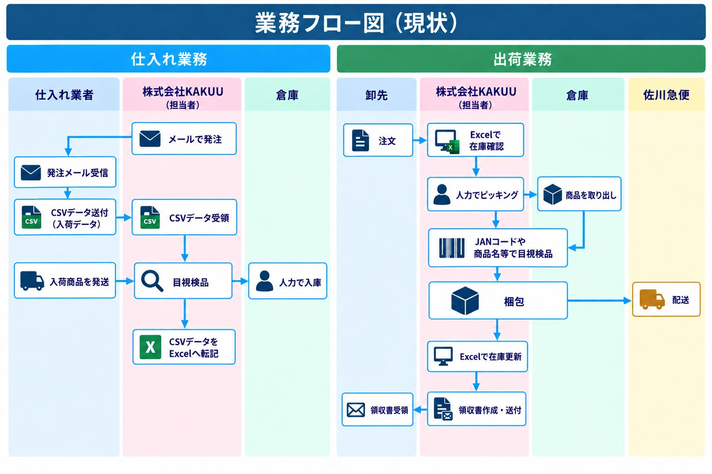
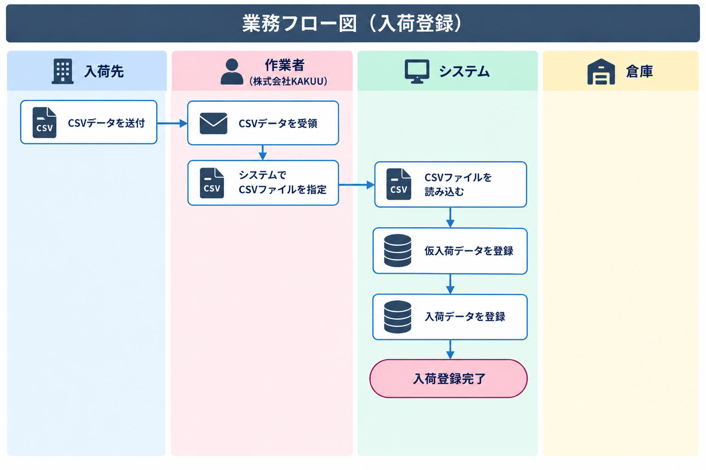
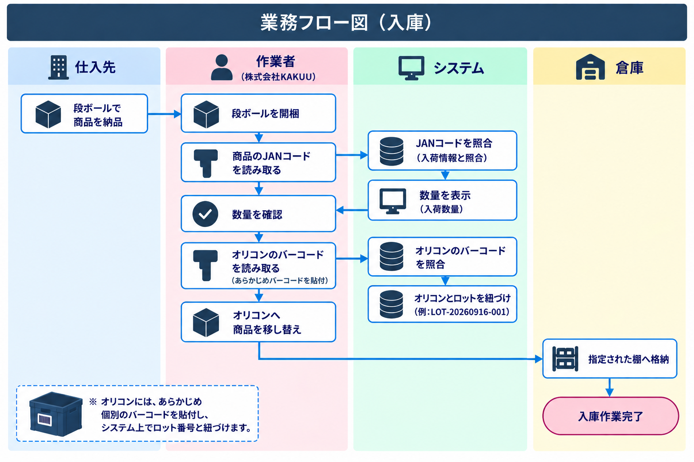
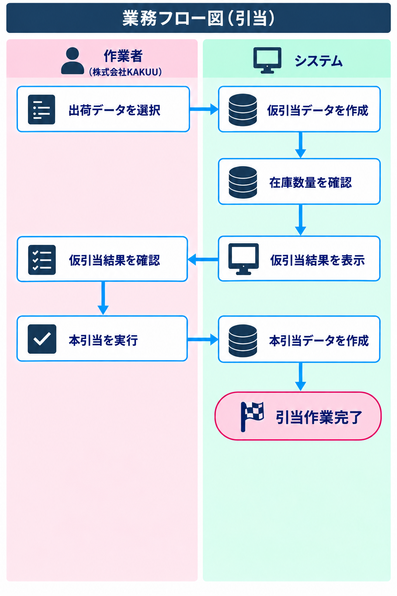
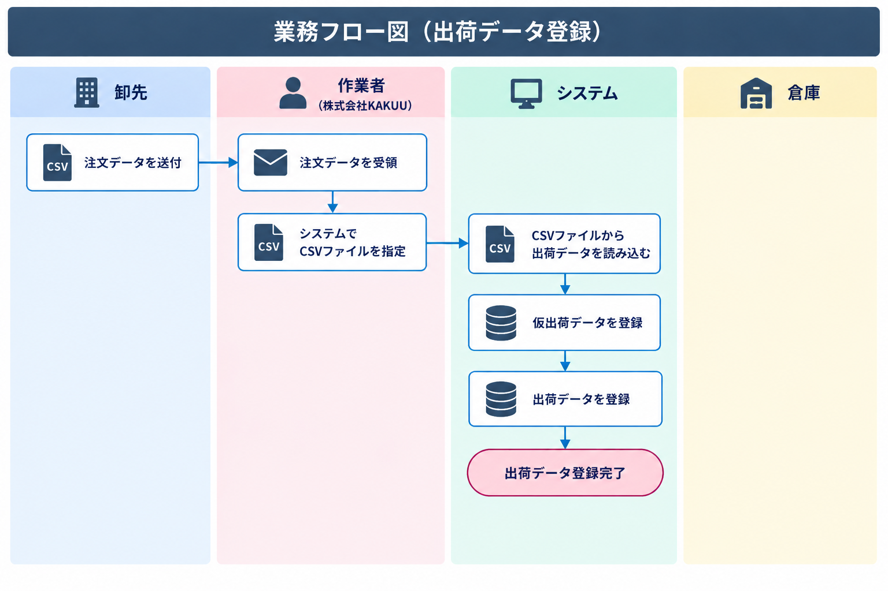
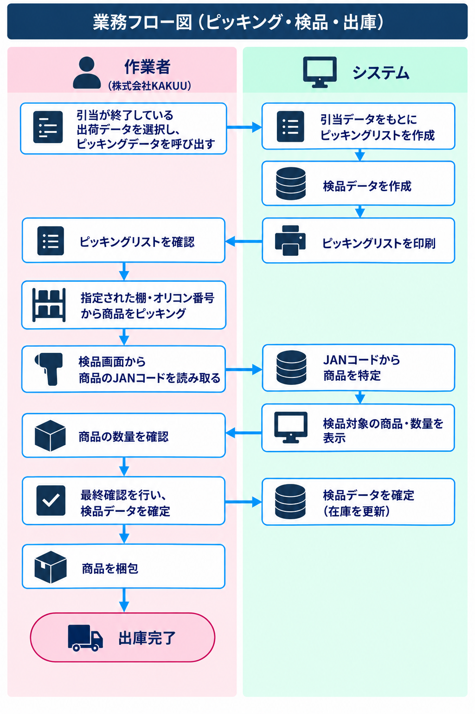

# 業務フロー図

本資料では、KAKUU WMSのシステム導入前と導入後の業務フロー図を掲載し、業務の流れを比較できるようにする。

## 1. 作図方法とAIの活用

業務フロー図の作成にはAIを活用した。業務の手順や図の構成に関する指示内容をExcelで整理し、その内容を基にAIへ図の作成を指示して、閲覧用のPNG画像を作成した。

`source/` に保存したExcelファイルは、**AIへの図作成指示用資料**であり、図を直接編集するためのファイルではない。

## 2. システム導入前の業務フロー図

要求分析で整理した現状の業務フローを、システム導入前の比較基準として掲載する。

**AIへの指示用資料**

- [業務フロー図（現状）.xlsx](01_システム導入前/source/業務フロー図（現状）.xlsx)

## 3. システム導入後の業務フロー図

システム導入後の業務フローを、業務別に掲載する。

### 3.1 入荷登録

### 3.2 入庫

### 3.3 引当

### 3.4 出荷登録

### 3.5 ピッキング・検品・出庫

**AIへの指示用資料**

- [業務フロー図（引当）.xlsx](02_システム導入後/source/業務フロー図（引当）.xlsx)
- [業務フロー図（ピッキング検品出庫）.xlsx](02_システム導入後/source/業務フロー図（ピッキング検品出庫）.xlsx)
