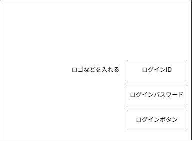
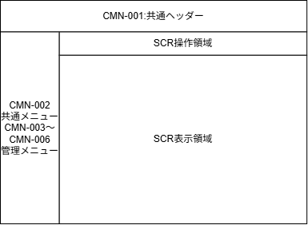

# 画面レイアウト（要件定義時イメージ）

要件定義時点で整理した、ログイン画面と全体画面の初期イメージを掲載する。

これらは**要件定義時点の暫定的な画面イメージ**であり、正式な外部設計で確定した画面レイアウトではない。具体的な表示項目・配置・操作条件などは、後続の外部設計で詳細化する。

## ログイン画面イメージ

[ログイン画面イメージの編集元（draw.io）](./source/ログイン画面イメージ.drawio)

## 全体画面イメージ

[全体画面イメージの編集元（draw.io）](./source/全体画面イメージ.drawio)
