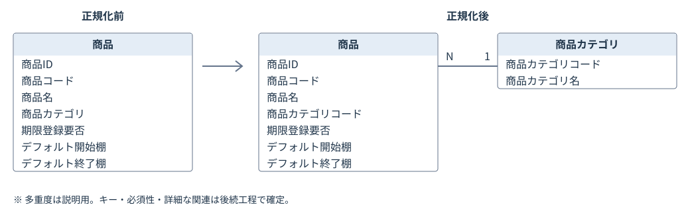
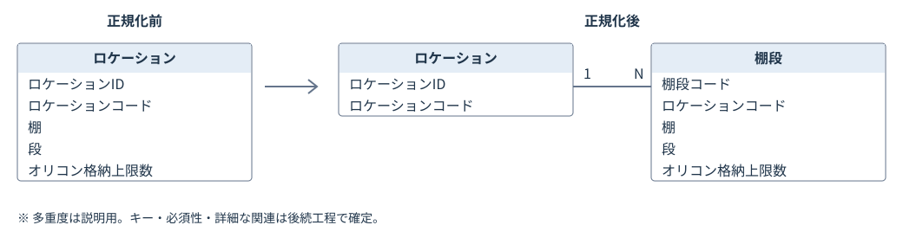
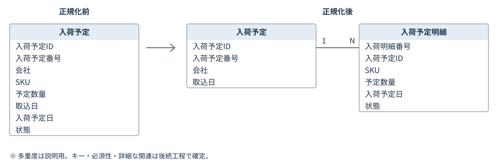
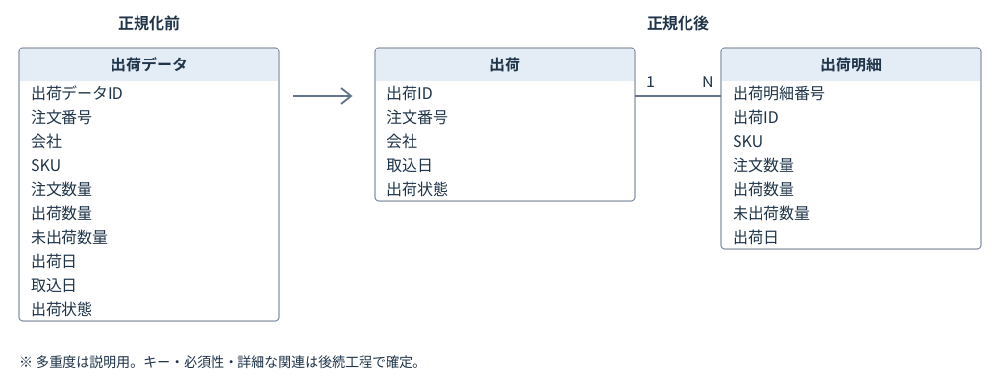
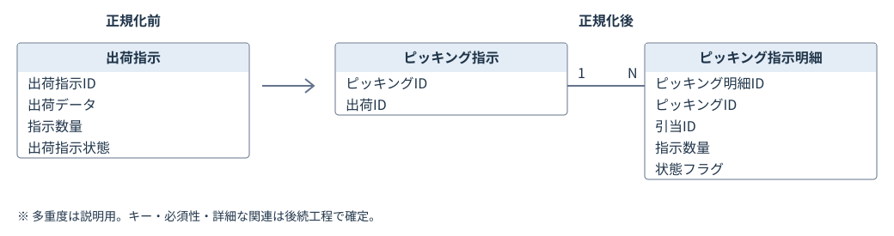

# KAKUU WMS 論理エンティティ正規化

## 1. 目的・整理方針

Issue #61の成果物として、論理エンティティ一覧の初期版を基準に、土台Excelで分割対象となった5件の正規化前後を整理する。
また、正規化によるエンティティ構成の変化および分割後のエンティティ間の関係・多重度を視覚的に説明するため、簡易ER図を作成する。

- 正規化前は初期版の名称・属性を使用する。
- 正規化後は既存属性と分割・参照に必要な属性に限定する。
- 追加業務属性・共通管理項目はIssue #62、キーの確定はIssue #63で扱う。
- 識別・参照用の属性名は暫定とし、PK・FKは確定しない。
- 正規化前後は分割の段階を示し、特定の正規形への到達を保証しない。

## 2. 正規化内容

### 2.1 商品

#### 正規化前

**商品**

| 属性 |
| --- |
| 商品ID |
| 商品コード |
| 商品名 |
| 商品カテゴリ |
| 期限登録要否 |
| デフォルト開始棚 |
| デフォルト終了棚 |

#### 正規化後

**商品**

| 属性 |
| --- |
| 商品ID |
| 商品コード |
| 商品名 |
| 商品カテゴリコード |
| 期限登録要否 |
| デフォルト開始棚 |
| デフォルト終了棚 |

**商品カテゴリ**

| 属性 |
| --- |
| 商品カテゴリコード |
| 商品カテゴリ名 |

#### 正規化理由

商品カテゴリを独立管理し、カテゴリ情報の重複保持と更新漏れを防ぐ。商品カテゴリコードは分離に伴う識別・参照用の属性とする。

### 2.2 ロケーション

#### 正規化前

**ロケーション**

| 属性 |
| --- |
| ロケーションID |
| ロケーションコード |
| 棚 |
| 段 |
| オリコン格納上限数 |

#### 正規化後

**ロケーション**

| 属性 |
| --- |
| ロケーションID |
| ロケーションコード |

**棚段**

| 属性 |
| --- |
| 棚段コード |
| ロケーションコード |
| 棚 |
| 段 |
| オリコン格納上限数 |

#### 正規化理由

ロケーション単位と棚段単位の情報を分離し、オリコン格納上限数を棚段単位で管理する。棚・段の個別保持の要否は属性定義で確認する。

### 2.3 入荷予定

#### 正規化前

**入荷予定**

| 属性 |
| --- |
| 入荷予定ID |
| 入荷予定番号 |
| 会社 |
| SKU |
| 予定数量 |
| 取込日 |
| 入荷予定日 |
| 状態 |

#### 正規化後

**入荷予定**

| 属性 |
| --- |
| 入荷予定ID |
| 入荷予定番号 |
| 会社 |
| 取込日 |

**入荷予定明細**

| 属性 |
| --- |
| 入荷明細番号 |
| 入荷予定ID |
| SKU |
| 予定数量 |
| 入荷予定日 |
| 状態 |

#### 正規化理由

入荷予定全体の共通情報と個別明細を分離し、共通情報の重複保持を防ぐ。

### 2.4 出荷

#### 正規化前

**出荷データ**

| 属性 |
| --- |
| 出荷データID |
| 注文番号 |
| 会社 |
| SKU |
| 注文数量 |
| 出荷数量 |
| 未出荷数量 |
| 出荷日 |
| 取込日 |
| 出荷状態 |

#### 正規化後

**出荷**

| 属性 |
| --- |
| 出荷ID |
| 注文番号 |
| 会社 |
| 取込日 |
| 出荷状態 |

**出荷明細**

| 属性 |
| --- |
| 出荷明細番号 |
| 出荷ID |
| SKU |
| 注文数量 |
| 出荷数量 |
| 未出荷数量 |
| 出荷日 |

#### 正規化理由

注文全体の共通情報と個別明細を分離し、明細単位の数量管理を可能にする。出荷データIDは分割後の出荷IDに対応する。出荷状態の管理単位は属性定義で確認する。

### 2.5 ピッキング指示

#### 正規化前

**出荷指示**

| 属性 |
| --- |
| 出荷指示ID |
| 出荷データ |
| 指示数量 |
| 出荷指示状態 |

#### 正規化後

**ピッキング指示**

| 属性 |
| --- |
| ピッキングID |
| 出荷ID |

**ピッキング指示明細**

| 属性 |
| --- |
| ピッキング明細ID |
| ピッキングID |
| 引当ID |
| 指示数量 |
| 状態フラグ |

#### 正規化理由

出荷指示をピッキング指示とピッキング指示明細に分離する。出荷IDを参照し、個別の指示をピッキングIDで識別する。引当IDは明細と引当情報を対応付けるために保持する。SKUは引当情報から取得する。出荷指示状態は状態フラグで管理する方針とし、具体的な状態定義は後続工程で行う。

## 3. 後続工程への引継ぎ

土台Excelの追加属性は本資料の確定属性に含めず、Issue #62で検討する。

| 対象 | 引継ぎ事項 |
| --- | --- |
| 商品 | デフォルト期限情報等の追加属性 |
| ロケーション・棚段 | ロケーション名、メモ、棚・段の保持方法 |
| 入荷予定明細 | 期限情報の追加、入荷実績の参照単位 |
| 出荷・出荷明細 | 出荷状態の管理単位、未出荷数量の保持方法、複数回出荷時の出荷日・数量の扱い |
| ピッキング指示明細 | ロケーション・オリコン・ロットは指示作成時点の履歴として保持する方針。ピッキング数量は将来拡張に備えて保持する方針。具体的な属性定義は#62で行う |
| 共通 | 状態フラグの詳細、追加日、変更日、更新者等の共通管理項目 |
| キー | ID・コード・番号の採否、PK・FK、一意性は#63で確定する |

初期版に存在する商品ID・ロケーションID・未出荷数量等は、土台Excelで省略されていても本段階では削除を確定しない。分割に伴う他エンティティの参照先変更は後続の属性定義・キー設計で確認する。
