# KAKUU WMS 論理ER図

## 1. 目的

正規化・属性定義・キー設計の結果を基に、論理エンティティ間の関連および多重度を整理し、論理ER図として可視化する。

エンティティごとに関連するエンティティおよび参照属性を明確にし、後続の物理データ設計の基礎資料とする。

## 2. 表記方法

### 2.1 ER図の記法

論理ER図はIE記法（カラスの足記法）を用いて作成する。

エンティティは矩形で表現し、エンティティ間の関連は関連線で表現する。

#### 関連線の表記方法

関連線は、FKの設定有無によって区別する。

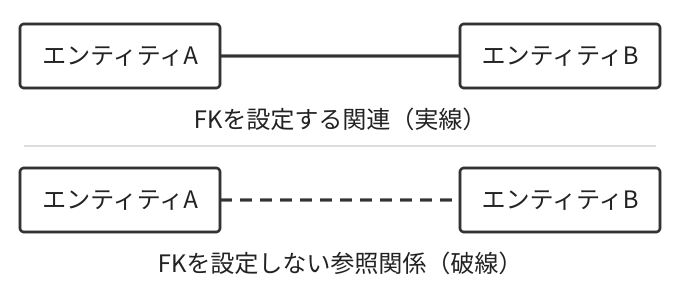

FKを設定しない参照関係には、ID保持・スナップショット・登録者・更新者による参照を含む。

#### 多重度の表記方法

論理ER図では、以下の4種類の多重度を基本とする。

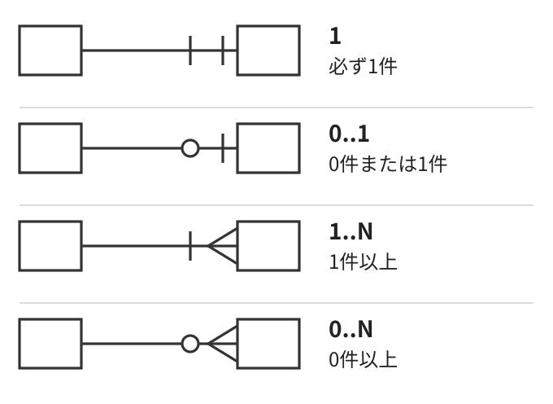

論理ER図ではIE記法を使用し、本資料内で関連および多重度を整理する際は、数値による表記を併用する。

#### 多重度の判定基準

FKを設定する関連の多重度は、論理削除済みを含む保持中の全データを基準とする。有効データまたは論理削除されていないデータに限定した一意性や業務上の制限は、基本の多重度と区別して補足する。

| 関連の種類 | 多重度の判定基準 |
| --- | --- |
| FK | FKの必須・任意、一意性および業務上の最小件数に基づく |
| ID保持 | 参照先の物理削除を許容するため、参照先側は0..1とする |
| スナップショット | 情報取得時点の関連に基づく多重度を付与する |
| 共通参照 | 社員の物理削除を許容するため、社員側は0..1とする |

スナップショットの多重度は取得時点の関係を示し、保持した値による現在のレコードの特定、値の一致および参照先の存在を保証するものではない。

属性の必須・任意と参照先レコードの存在は区別する。FKを設定しない必須属性は値の保持を要求するが、取得後の参照先の永続的な存在は要求しない。

入荷予定、出荷、ピッキング指示は、それぞれ対応する明細を1件以上持つことを必須とし、親側を1、明細側を1..Nとする。

### 2.2 キー・参照属性の表記方法

関連一覧および論理ER図では、キー・参照属性を以下のように区別する。

| 表記 | 意味 |
| --- | --- |
| PK | 主キー |
| FK | 外部キー |
| ID保持 | FKを設定せず、参照先のIDを保持する属性 |
| スナップショット | 業務処理時点の情報を保持する属性 |
| 共通参照 | 登録者・更新者として社員IDを保持する属性 |

エンティティ名および属性名は、論理エンティティ属性定義および論理エンティティキー設計に従う。

### 2.3 関連一覧の表記方法

関連一覧は、エンティティごとに作成する。

対象エンティティが参照する関連および参照される関連の両方を記載する。

| 項目 | 内容 |
| --- | --- |
| テーブル | 対象エンティティ名 |
| 関連キー | 対象エンティティ側の関連キー・参照属性 |
| 多重度 | 対象エンティティ側の多重度 |
| 関連元テーブル | 関連するエンティティ名 |
| 関連キー | 関連するエンティティ側の関連キー・参照属性 |
| 多重度 | 関連するエンティティ側の多重度 |

多重度は各エンティティ側の件数を示す。スナップショットの多重度は取得時点を基準とし、保持先側は複数回の取得結果を含め0..Nとする。属性の必須・任意は論理エンティティ属性定義に従う。

FKを設定する関連だけでなく、ID保持・スナップショット・登録者・更新者による参照関係も記載する。

### 2.4 論理ER図の表示方法

エンティティごとに折りたたみ形式で関連一覧および論理ER図を記載する。

論理ER図はSVG形式とし、対象エンティティおよび関連一覧に記載した関連エンティティのみを表示する。

エンティティ内には、関連するキー・参照属性のみを表示する。

図の作成にあたっては、以下の点に留意する。

- エンティティ同士を重ねない。
- 関連線が他のエンティティに重ならないようにする。
- 複数の関連線が接続される場合は、接続箇所を分散する。
- 可能な限り関連線同士の重複・交差を避ける。

全エンティティを対象とした全体ER図は本資料の作成時点では対象外とし、必要性を後程検討する。

## 3. 論理ER図

関連一覧には直接の参照関係およびスナップショットの取得元を記載する。スナップショットは現在の値の一致や参照先の存在を保証するものではない。社員の自己参照は重複記載しない。

商品

| テーブル | 関連キー | 多重度 | 関連元テーブル | 関連キー | 多重度 |
| --- | --- | :---: | --- | --- | :---: |
| 商品 | 商品カテゴリコード（FK） | 0..N | 商品カテゴリ | 商品カテゴリコード（PK） | 1 |
| 商品 | 商品ID（PK） | 1 | SKU | 商品ID（FK） | 0..N |
| 商品 | 登録者（共通参照） | 0..N | 社員 | 社員ID（PK） | 0..1 |
| 商品 | 更新者（共通参照） | 0..N | 社員 | 社員ID（PK） | 0..1 |

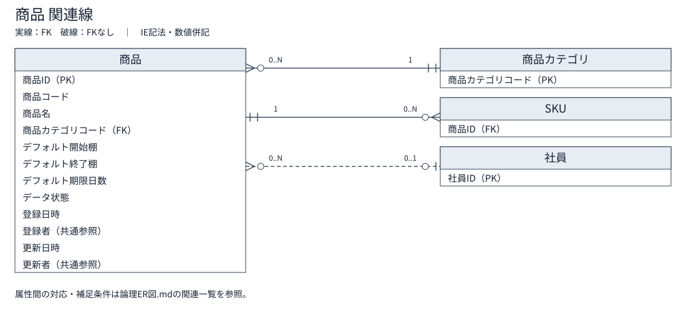

商品カテゴリ

| テーブル | 関連キー | 多重度 | 関連元テーブル | 関連キー | 多重度 |
| --- | --- | :---: | --- | --- | :---: |
| 商品カテゴリ | 商品カテゴリコード（PK） | 1 | 商品 | 商品カテゴリコード（FK） | 0..N |
| 商品カテゴリ | 登録者（共通参照） | 0..N | 社員 | 社員ID（PK） | 0..1 |
| 商品カテゴリ | 更新者（共通参照） | 0..N | 社員 | 社員ID（PK） | 0..1 |

SKU

| テーブル | 関連キー | 多重度 | 関連元テーブル | 関連キー | 多重度 |
| --- | --- | :---: | --- | --- | :---: |
| SKU | 商品ID（FK） | 0..N | 商品 | 商品ID（PK） | 1 |
| SKU | SKUID（PK） | 1 | 入荷予定明細 | SKUID（FK） | 0..N |
| SKU | SKUID（PK） | 1 | ロット | SKUID（FK） | 0..N |
| SKU | SKUID（PK） | 1 | 在庫 | SKUID（FK） | 0..N |
| SKU | SKUID（PK） | 1 | 出荷明細 | SKUID（FK） | 0..N |
| SKU | SKUコード | 1 | 本引当情報 | SKUコード（スナップショット） | 0..N |
| SKU | 登録者（共通参照） | 0..N | 社員 | 社員ID（PK） | 0..1 |
| SKU | 更新者（共通参照） | 0..N | 社員 | 社員ID（PK） | 0..1 |

会社

| テーブル | 関連キー | 多重度 | 関連元テーブル | 関連キー | 多重度 |
| --- | --- | :---: | --- | --- | :---: |
| 会社 | 会社ID（PK） | 1 | 会社別名 | 会社ID（FK） | 0..N |
| 会社 | 会社ID（PK） | 1 | CSV取込設定 | 会社ID（FK） | 0..N |
| 会社 | 会社ID（PK） | 1 | 入荷予定 | 会社ID（FK） | 0..N |
| 会社 | 会社ID（PK） | 1 | 出荷 | 会社ID（FK） | 0..N |
| 会社 | 会社コード | 1 | CSV取込結果 | 会社コード（スナップショット） | 0..N |
| 会社 | 登録者（共通参照） | 0..N | 社員 | 社員ID（PK） | 0..1 |
| 会社 | 更新者（共通参照） | 0..N | 社員 | 社員ID（PK） | 0..1 |

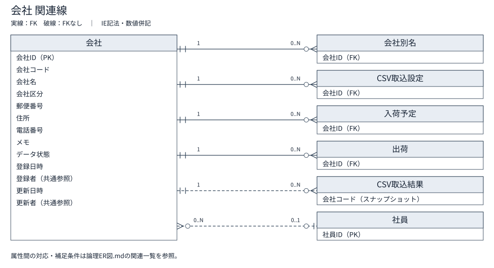

会社別名

| テーブル | 関連キー | 多重度 | 関連元テーブル | 関連キー | 多重度 |
| --- | --- | :---: | --- | --- | :---: |
| 会社別名 | 会社ID（FK） | 0..N | 会社 | 会社ID（PK） | 1 |
| 会社別名 | 登録者（共通参照） | 0..N | 社員 | 社員ID（PK） | 0..1 |
| 会社別名 | 更新者（共通参照） | 0..N | 社員 | 社員ID（PK） | 0..1 |

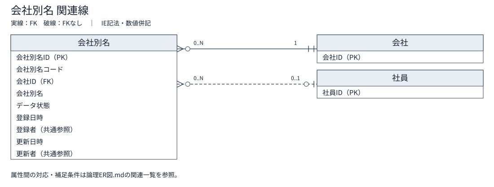

社員

| テーブル | 関連キー | 多重度 | 関連元テーブル | 関連キー | 多重度 |
| --- | --- | :---: | --- | --- | :---: |
| 社員 | 社員ID（PK） | 0..1 | 商品 | 登録者（共通参照） | 0..N |
| 社員 | 社員ID（PK） | 0..1 | 商品 | 更新者（共通参照） | 0..N |
| 社員 | 社員ID（PK） | 0..1 | 商品カテゴリ | 登録者（共通参照） | 0..N |
| 社員 | 社員ID（PK） | 0..1 | 商品カテゴリ | 更新者（共通参照） | 0..N |
| 社員 | 社員ID（PK） | 0..1 | SKU | 登録者（共通参照） | 0..N |
| 社員 | 社員ID（PK） | 0..1 | SKU | 更新者（共通参照） | 0..N |
| 社員 | 社員ID（PK） | 0..1 | 会社 | 登録者（共通参照） | 0..N |
| 社員 | 社員ID（PK） | 0..1 | 会社 | 更新者（共通参照） | 0..N |
| 社員 | 社員ID（PK） | 0..1 | 会社別名 | 登録者（共通参照） | 0..N |
| 社員 | 社員ID（PK） | 0..1 | 会社別名 | 更新者（共通参照） | 0..N |
| 社員 | 登録者（共通参照） | 0..N | 社員 | 社員ID（PK） | 0..1 |
| 社員 | 更新者（共通参照） | 0..N | 社員 | 社員ID（PK） | 0..1 |
| 社員 | 社員ID（PK） | 0..1 | ロケーション | 登録者（共通参照） | 0..N |
| 社員 | 社員ID（PK） | 0..1 | ロケーション | 更新者（共通参照） | 0..N |
| 社員 | 社員ID（PK） | 0..1 | 棚段 | 登録者（共通参照） | 0..N |
| 社員 | 社員ID（PK） | 0..1 | 棚段 | 更新者（共通参照） | 0..N |
| 社員 | 社員ID（PK） | 0..1 | オリコン | 登録者（共通参照） | 0..N |
| 社員 | 社員ID（PK） | 0..1 | オリコン | 更新者（共通参照） | 0..N |
| 社員 | 社員ID（PK） | 0..1 | CSV取込設定 | 登録者（共通参照） | 0..N |
| 社員 | 社員ID（PK） | 0..1 | CSV取込設定 | 更新者（共通参照） | 0..N |
| 社員 | 社員ID（PK） | 0..1 | 読み取り設定 | 登録者（共通参照） | 0..N |
| 社員 | 社員ID（PK） | 0..1 | 読み取り設定 | 更新者（共通参照） | 0..N |
| 社員 | 社員ID（PK） | 0..1 | 入荷予定 | 登録者（共通参照） | 0..N |
| 社員 | 社員ID（PK） | 0..1 | 入荷予定 | 更新者（共通参照） | 0..N |
| 社員 | 社員ID（PK） | 0..1 | 入荷予定明細 | 登録者（共通参照） | 0..N |
| 社員 | 社員ID（PK） | 0..1 | 入荷予定明細 | 更新者（共通参照） | 0..N |
| 社員 | 社員ID（PK） | 0..1 | 入荷実績 | 登録者（共通参照） | 0..N |
| 社員 | 社員ID（PK） | 0..1 | 入荷実績 | 更新者（共通参照） | 0..N |
| 社員 | 社員ID（PK） | 0..1 | ロット | 登録者（共通参照） | 0..N |
| 社員 | 社員ID（PK） | 0..1 | ロット | 更新者（共通参照） | 0..N |
| 社員 | 社員ID（PK） | 0..1 | 入庫実績 | 登録者（共通参照） | 0..N |
| 社員 | 社員ID（PK） | 0..1 | 入庫実績 | 更新者（共通参照） | 0..N |
| 社員 | 社員ID（PK） | 0..1 | 在庫 | 登録者（共通参照） | 0..N |
| 社員 | 社員ID（PK） | 0..1 | 在庫 | 更新者（共通参照） | 0..N |
| 社員 | 社員ID（PK） | 0..1 | 出荷 | 登録者（共通参照） | 0..N |
| 社員 | 社員ID（PK） | 0..1 | 出荷 | 更新者（共通参照） | 0..N |
| 社員 | 社員ID（PK） | 0..1 | 出荷明細 | 登録者（共通参照） | 0..N |
| 社員 | 社員ID（PK） | 0..1 | 出荷明細 | 更新者（共通参照） | 0..N |
| 社員 | 社員ID（PK） | 0..1 | 仮引当情報 | 登録者（共通参照） | 0..N |
| 社員 | 社員ID（PK） | 0..1 | 仮引当情報 | 更新者（共通参照） | 0..N |
| 社員 | 社員ID（PK） | 0..1 | 本引当情報 | 登録者（共通参照） | 0..N |
| 社員 | 社員ID（PK） | 0..1 | 本引当情報 | 更新者（共通参照） | 0..N |
| 社員 | 社員ID（PK） | 0..1 | ピッキング指示 | 登録者（共通参照） | 0..N |
| 社員 | 社員ID（PK） | 0..1 | ピッキング指示 | 更新者（共通参照） | 0..N |
| 社員 | 社員ID（PK） | 0..1 | ピッキング指示明細 | 登録者（共通参照） | 0..N |
| 社員 | 社員ID（PK） | 0..1 | ピッキング指示明細 | 更新者（共通参照） | 0..N |
| 社員 | 社員ID（PK） | 0..1 | 出荷検品結果 | 登録者（共通参照） | 0..N |
| 社員 | 社員ID（PK） | 0..1 | 出荷検品結果 | 更新者（共通参照） | 0..N |
| 社員 | 社員ID（PK） | 0..1 | CSV取込結果 | 登録者（共通参照） | 0..N |

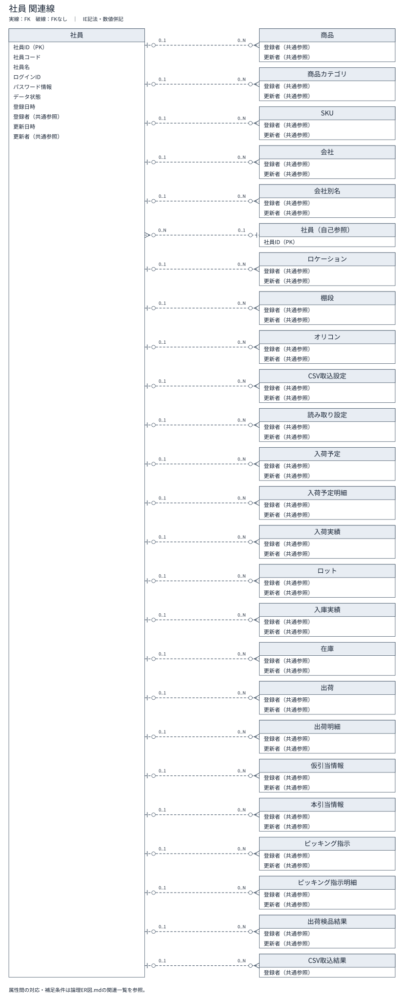

ロケーション

| テーブル | 関連キー | 多重度 | 関連元テーブル | 関連キー | 多重度 |
| --- | --- | :---: | --- | --- | :---: |
| ロケーション | ロケーションID（PK） | 1 | 棚段 | ロケーションID（FK） | 0..N |
| ロケーション | 登録者（共通参照） | 0..N | 社員 | 社員ID（PK） | 0..1 |
| ロケーション | 更新者（共通参照） | 0..N | 社員 | 社員ID（PK） | 0..1 |

棚段

| テーブル | 関連キー | 多重度 | 関連元テーブル | 関連キー | 多重度 |
| --- | --- | :---: | --- | --- | :---: |
| 棚段 | ロケーションID（FK） | 0..N | ロケーション | ロケーションID（PK） | 1 |
| 棚段 | 棚段ID（PK） | 0..1 | オリコン | 棚段ID（FK） | 0..N |
| 棚段 | 棚段コード | 1 | 入庫実績 | 棚段コード（スナップショット） | 0..N |
| 棚段 | 棚段コード | 1 | 本引当情報 | 棚段コード（スナップショット） | 0..N |
| 棚段 | 登録者（共通参照） | 0..N | 社員 | 社員ID（PK） | 0..1 |
| 棚段 | 更新者（共通参照） | 0..N | 社員 | 社員ID（PK） | 0..1 |

オリコン

| テーブル | 関連キー | 多重度 | 関連元テーブル | 関連キー | 多重度 |
| --- | --- | :---: | --- | --- | :---: |
| オリコン | 棚段ID（FK） | 0..N | 棚段 | 棚段ID（PK） | 0..1 |
| オリコン | オリコンID（PK） | 1 | 入庫実績 | オリコンID（FK） | 0..N |
| オリコン | オリコンID（PK） | 1 | 在庫 | オリコンID（FK） | 0..N |
| オリコン | オリコン番号 | 1 | 本引当情報 | オリコン番号（スナップショット） | 0..N |
| オリコン | 登録者（共通参照） | 0..N | 社員 | 社員ID（PK） | 0..1 |
| オリコン | 更新者（共通参照） | 0..N | 社員 | 社員ID（PK） | 0..1 |

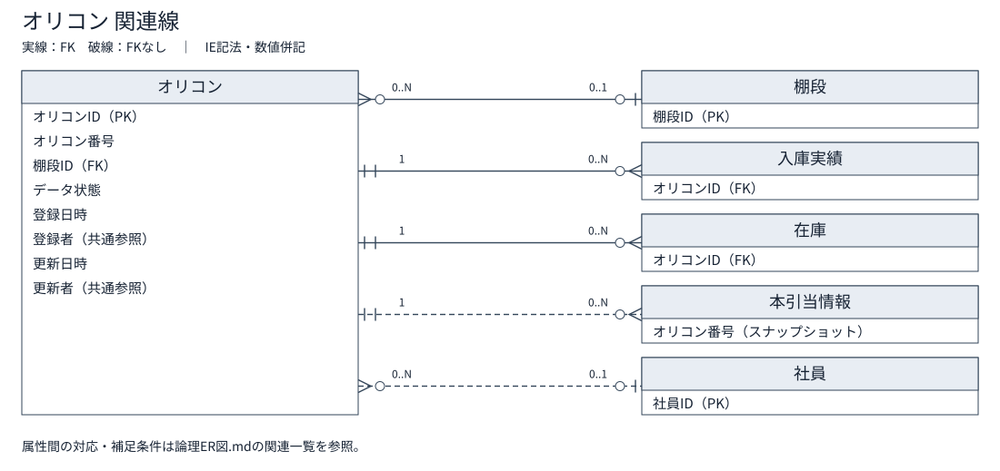

CSV取込設定

| テーブル | 関連キー | 多重度 | 関連元テーブル | 関連キー | 多重度 |
| --- | --- | :---: | --- | --- | :---: |
| CSV取込設定 | 会社ID（FK） | 0..N | 会社 | 会社ID（PK） | 1 |
| CSV取込設定 | 読み取り設定ID（FK） | 0..N | 読み取り設定 | 読み取り設定ID（PK） | 1 |
| CSV取込設定 | 登録者（共通参照） | 0..N | 社員 | 社員ID（PK） | 0..1 |
| CSV取込設定 | 更新者（共通参照） | 0..N | 社員 | 社員ID（PK） | 0..1 |

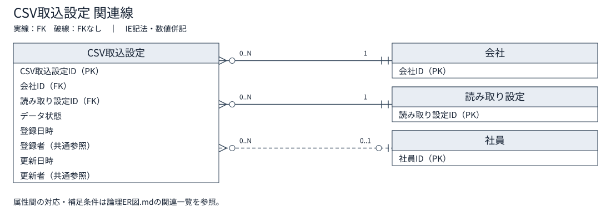

読み取り設定

| テーブル | 関連キー | 多重度 | 関連元テーブル | 関連キー | 多重度 |
| --- | --- | :---: | --- | --- | :---: |
| 読み取り設定 | 読み取り設定ID（PK） | 1 | CSV取込設定 | 読み取り設定ID（FK） | 0..N |
| 読み取り設定 | 登録者（共通参照） | 0..N | 社員 | 社員ID（PK） | 0..1 |
| 読み取り設定 | 更新者（共通参照） | 0..N | 社員 | 社員ID（PK） | 0..1 |

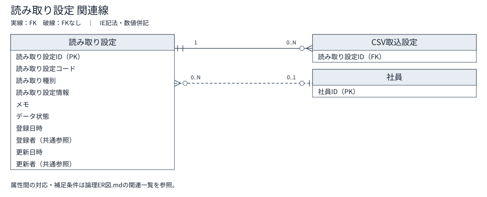

入荷予定

| テーブル | 関連キー | 多重度 | 関連元テーブル | 関連キー | 多重度 |
| --- | --- | :---: | --- | --- | :---: |
| 入荷予定 | 会社ID（FK） | 0..N | 会社 | 会社ID（PK） | 1 |
| 入荷予定 | 入荷予定ID（PK） | 1 | 入荷予定明細 | 入荷予定ID（FK） | 1..N |
| 入荷予定 | CSV取込結果ID（ID保持） | 0..N | CSV取込結果 | CSV取込結果ID（PK） | 0..1 |
| 入荷予定 | 登録者（共通参照） | 0..N | 社員 | 社員ID（PK） | 0..1 |
| 入荷予定 | 更新者（共通参照） | 0..N | 社員 | 社員ID（PK） | 0..1 |

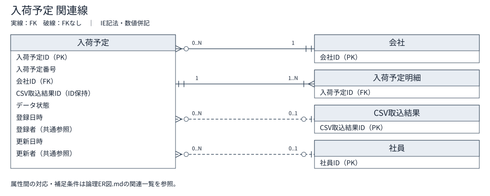

入荷予定明細

| テーブル | 関連キー | 多重度 | 関連元テーブル | 関連キー | 多重度 |
| --- | --- | :---: | --- | --- | :---: |
| 入荷予定明細 | 入荷予定ID（FK） | 1..N | 入荷予定 | 入荷予定ID（PK） | 1 |
| 入荷予定明細 | SKUID（FK） | 0..N | SKU | SKUID（PK） | 1 |
| 入荷予定明細 | 入荷予定明細ID（PK） | 1 | 入荷実績 | 入荷予定明細ID（FK） | 0..N |
| 入荷予定明細 | 登録者（共通参照） | 0..N | 社員 | 社員ID（PK） | 0..1 |
| 入荷予定明細 | 更新者（共通参照） | 0..N | 社員 | 社員ID（PK） | 0..1 |

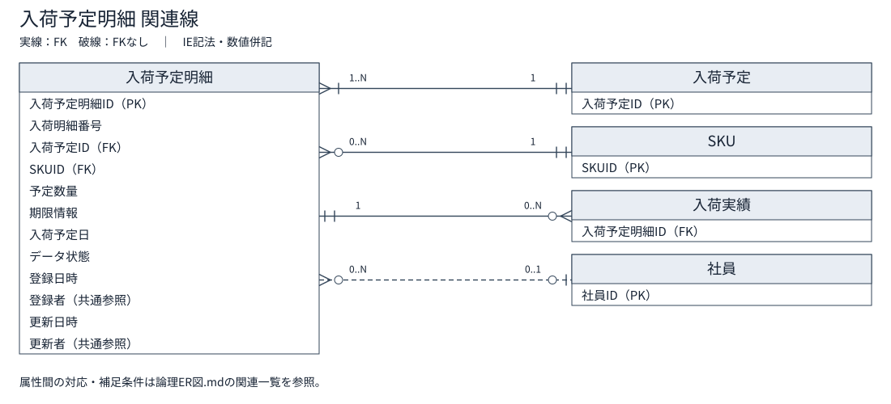

入荷実績

| テーブル | 関連キー | 多重度 | 関連元テーブル | 関連キー | 多重度 |
| --- | --- | :---: | --- | --- | :---: |
| 入荷実績 | 入荷予定明細ID（FK） | 0..N | 入荷予定明細 | 入荷予定明細ID（PK） | 1 |
| 入荷実績 | 入荷実績ID（PK） | 1 | 入庫実績 | 入荷実績ID（FK） | 0..N |
| 入荷実績 | 登録者（共通参照） | 0..N | 社員 | 社員ID（PK） | 0..1 |
| 入荷実績 | 更新者（共通参照） | 0..N | 社員 | 社員ID（PK） | 0..1 |

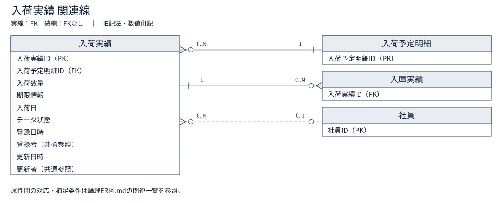

ロット

| テーブル | 関連キー | 多重度 | 関連元テーブル | 関連キー | 多重度 |
| --- | --- | :---: | --- | --- | :---: |
| ロット | SKUID（FK） | 0..N | SKU | SKUID（PK） | 1 |
| ロット | ロットID（PK） | 1 | 入庫実績 | ロットID（FK） | 0..N |
| ロット | ロットID（PK） | 1 | 在庫 | ロットID（FK） | 0..N |
| ロット | ロット番号 | 1 | 本引当情報 | ロット番号（スナップショット） | 0..N |
| ロット | 期限情報 | 1 | 本引当情報 | 期限情報（スナップショット） | 0..N |
| ロット | 登録者（共通参照） | 0..N | 社員 | 社員ID（PK） | 0..1 |
| ロット | 更新者（共通参照） | 0..N | 社員 | 社員ID（PK） | 0..1 |

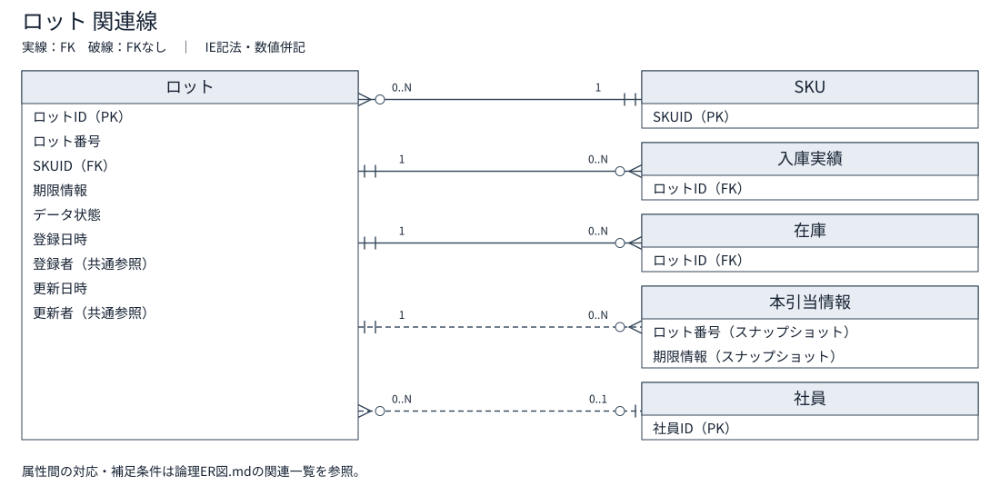

入庫実績

| テーブル | 関連キー | 多重度 | 関連元テーブル | 関連キー | 多重度 |
| --- | --- | :---: | --- | --- | :---: |
| 入庫実績 | 入荷実績ID（FK） | 0..N | 入荷実績 | 入荷実績ID（PK） | 1 |
| 入庫実績 | ロットID（FK） | 0..N | ロット | ロットID（PK） | 1 |
| 入庫実績 | オリコンID（FK） | 0..N | オリコン | オリコンID（PK） | 1 |
| 入庫実績 | 棚段コード（スナップショット） | 0..N | 棚段 | 棚段コード | 1 |
| 入庫実績 | 登録者（共通参照） | 0..N | 社員 | 社員ID（PK） | 0..1 |
| 入庫実績 | 更新者（共通参照） | 0..N | 社員 | 社員ID（PK） | 0..1 |

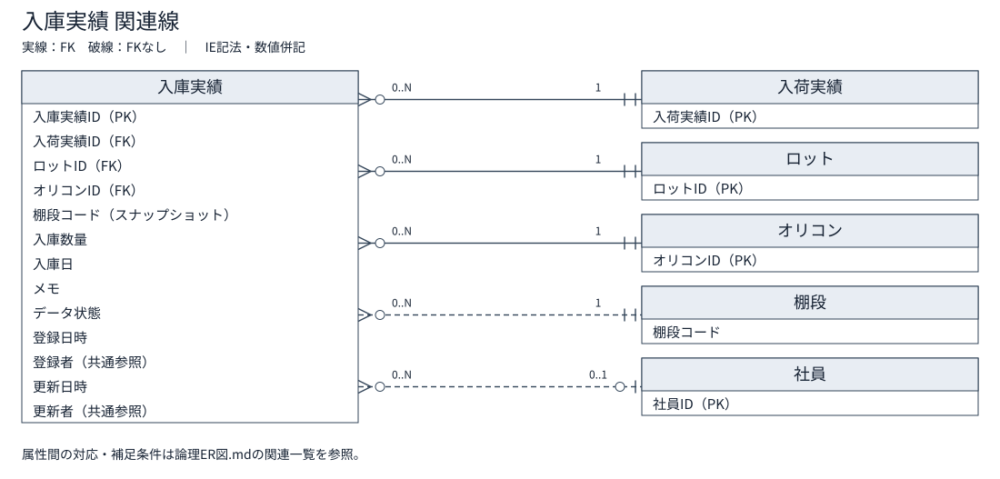

在庫

| テーブル | 関連キー | 多重度 | 関連元テーブル | 関連キー | 多重度 |
| --- | --- | :---: | --- | --- | :---: |
| 在庫 | SKUID（FK） | 0..N | SKU | SKUID（PK） | 1 |
| 在庫 | ロットID（FK） | 0..N | ロット | ロットID（PK） | 1 |
| 在庫 | オリコンID（FK） | 0..N | オリコン | オリコンID（PK） | 1 |
| 在庫 | 在庫ID（PK） | 1 | 仮引当情報 | 在庫ID（FK） | 0..N |
| 在庫 | 在庫ID（PK） | 0..1 | 本引当情報 | 在庫ID（ID保持） | 0..N |
| 在庫 | 登録者（共通参照） | 0..N | 社員 | 社員ID（PK） | 0..1 |
| 在庫 | 更新者（共通参照） | 0..N | 社員 | 社員ID（PK） | 0..1 |

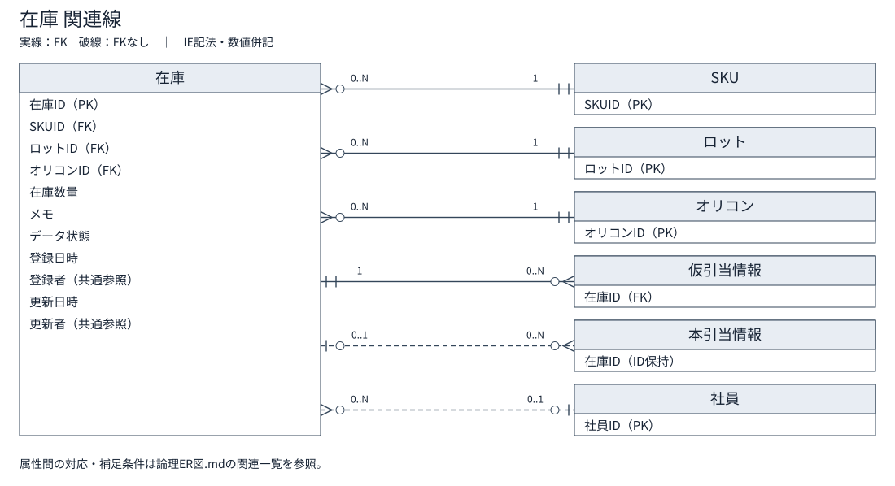

出荷

| テーブル | 関連キー | 多重度 | 関連元テーブル | 関連キー | 多重度 |
| --- | --- | :---: | --- | --- | :---: |
| 出荷 | 会社ID（FK） | 0..N | 会社 | 会社ID（PK） | 1 |
| 出荷 | 出荷ID（PK） | 1 | 出荷明細 | 出荷ID（FK） | 1..N |
| 出荷 | 出荷ID（PK） | 1 | ピッキング指示 | 出荷ID（FK） | 0..N |
| 出荷 | CSV取込結果ID（ID保持） | 0..N | CSV取込結果 | CSV取込結果ID（PK） | 0..1 |
| 出荷 | 登録者（共通参照） | 0..N | 社員 | 社員ID（PK） | 0..1 |
| 出荷 | 更新者（共通参照） | 0..N | 社員 | 社員ID（PK） | 0..1 |

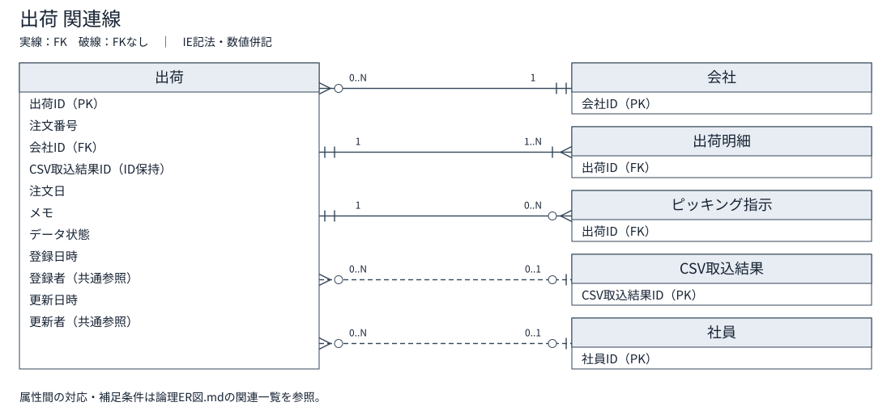

出荷明細

| テーブル | 関連キー | 多重度 | 関連元テーブル | 関連キー | 多重度 |
| --- | --- | :---: | --- | --- | :---: |
| 出荷明細 | 出荷ID（FK） | 1..N | 出荷 | 出荷ID（PK） | 1 |
| 出荷明細 | SKUID（FK） | 0..N | SKU | SKUID（PK） | 1 |
| 出荷明細 | 出荷明細ID（PK） | 1 | 仮引当情報 | 出荷明細ID（FK） | 0..N |
| 出荷明細 | 出荷明細ID（PK） | 1 | 本引当情報 | 出荷明細ID（FK） | 0..N |
| 出荷明細 | 登録者（共通参照） | 0..N | 社員 | 社員ID（PK） | 0..1 |
| 出荷明細 | 更新者（共通参照） | 0..N | 社員 | 社員ID（PK） | 0..1 |

仮引当情報

| テーブル | 関連キー | 多重度 | 関連元テーブル | 関連キー | 多重度 |
| --- | --- | :---: | --- | --- | :---: |
| 仮引当情報 | 出荷明細ID（FK） | 0..N | 出荷明細 | 出荷明細ID（PK） | 1 |
| 仮引当情報 | 在庫ID（FK） | 0..N | 在庫 | 在庫ID（PK） | 1 |
| 仮引当情報 | 登録者（共通参照） | 0..N | 社員 | 社員ID（PK） | 0..1 |
| 仮引当情報 | 更新者（共通参照） | 0..N | 社員 | 社員ID（PK） | 0..1 |

本引当情報

| テーブル | 関連キー | 多重度 | 関連元テーブル | 関連キー | 多重度 |
| --- | --- | :---: | --- | --- | :---: |
| 本引当情報 | 出荷明細ID（FK） | 0..N | 出荷明細 | 出荷明細ID（PK） | 1 |
| 本引当情報 | 本引当ID（PK） | 1 | ピッキング指示明細 | 本引当ID（FK） | 0..N |
| 本引当情報 | 在庫ID（ID保持） | 0..N | 在庫 | 在庫ID（PK） | 0..1 |
| 本引当情報 | SKUコード（スナップショット） | 0..N | SKU | SKUコード | 1 |
| 本引当情報 | ロット番号（スナップショット） | 0..N | ロット | ロット番号 | 1 |
| 本引当情報 | 期限情報（スナップショット） | 0..N | ロット | 期限情報 | 1 |
| 本引当情報 | オリコン番号（スナップショット） | 0..N | オリコン | オリコン番号 | 1 |
| 本引当情報 | 棚段コード（スナップショット） | 0..N | 棚段 | 棚段コード | 1 |
| 本引当情報 | 在庫ID | 1 | ピッキング指示明細 | 在庫ID（スナップショット） | 0..N |
| 本引当情報 | SKUコード | 1 | ピッキング指示明細 | SKUコード（スナップショット） | 0..N |
| 本引当情報 | ロット番号 | 1 | ピッキング指示明細 | ロット番号（スナップショット） | 0..N |
| 本引当情報 | オリコン番号 | 1 | ピッキング指示明細 | オリコン番号（スナップショット） | 0..N |
| 本引当情報 | 棚段コード | 1 | ピッキング指示明細 | 棚段コード（スナップショット） | 0..N |
| 本引当情報 | 期限情報 | 1 | ピッキング指示明細 | 期限情報（スナップショット） | 0..N |
| 本引当情報 | 引当数量 | 1 | ピッキング指示明細 | 指示数量（スナップショット） | 0..N |
| 本引当情報 | 登録者（共通参照） | 0..N | 社員 | 社員ID（PK） | 0..1 |
| 本引当情報 | 更新者（共通参照） | 0..N | 社員 | 社員ID（PK） | 0..1 |

ピッキング指示

| テーブル | 関連キー | 多重度 | 関連元テーブル | 関連キー | 多重度 |
| --- | --- | :---: | --- | --- | :---: |
| ピッキング指示 | 出荷ID（FK） | 0..N | 出荷 | 出荷ID（PK） | 1 |
| ピッキング指示 | ピッキングID（PK） | 1 | ピッキング指示明細 | ピッキングID（FK） | 1..N |
| ピッキング指示 | 登録者（共通参照） | 0..N | 社員 | 社員ID（PK） | 0..1 |
| ピッキング指示 | 更新者（共通参照） | 0..N | 社員 | 社員ID（PK） | 0..1 |

ピッキング指示明細

| テーブル | 関連キー | 多重度 | 関連元テーブル | 関連キー | 多重度 |
| --- | --- | :---: | --- | --- | :---: |
| ピッキング指示明細 | ピッキングID（FK） | 1..N | ピッキング指示 | ピッキングID（PK） | 1 |
| ピッキング指示明細 | 本引当ID（FK） | 0..N | 本引当情報 | 本引当ID（PK） | 1 |
| ピッキング指示明細 | ピッキング明細ID（PK） | 1 | 出荷検品結果 | ピッキング明細ID（FK） | 0..N |
| ピッキング指示明細 | 在庫ID（スナップショット） | 0..N | 本引当情報 | 在庫ID | 1 |
| ピッキング指示明細 | SKUコード（スナップショット） | 0..N | 本引当情報 | SKUコード | 1 |
| ピッキング指示明細 | ロット番号（スナップショット） | 0..N | 本引当情報 | ロット番号 | 1 |
| ピッキング指示明細 | オリコン番号（スナップショット） | 0..N | 本引当情報 | オリコン番号 | 1 |
| ピッキング指示明細 | 棚段コード（スナップショット） | 0..N | 本引当情報 | 棚段コード | 1 |
| ピッキング指示明細 | 期限情報（スナップショット） | 0..N | 本引当情報 | 期限情報 | 1 |
| ピッキング指示明細 | 指示数量（スナップショット） | 0..N | 本引当情報 | 引当数量 | 1 |
| ピッキング指示明細 | SKUコード | 1 | 出荷検品結果 | SKUコード（スナップショット） | 0..N |
| ピッキング指示明細 | 指示数量 | 1 | 出荷検品結果 | 指示数量（スナップショット） | 0..N |
| ピッキング指示明細 | 登録者（共通参照） | 0..N | 社員 | 社員ID（PK） | 0..1 |
| ピッキング指示明細 | 更新者（共通参照） | 0..N | 社員 | 社員ID（PK） | 0..1 |

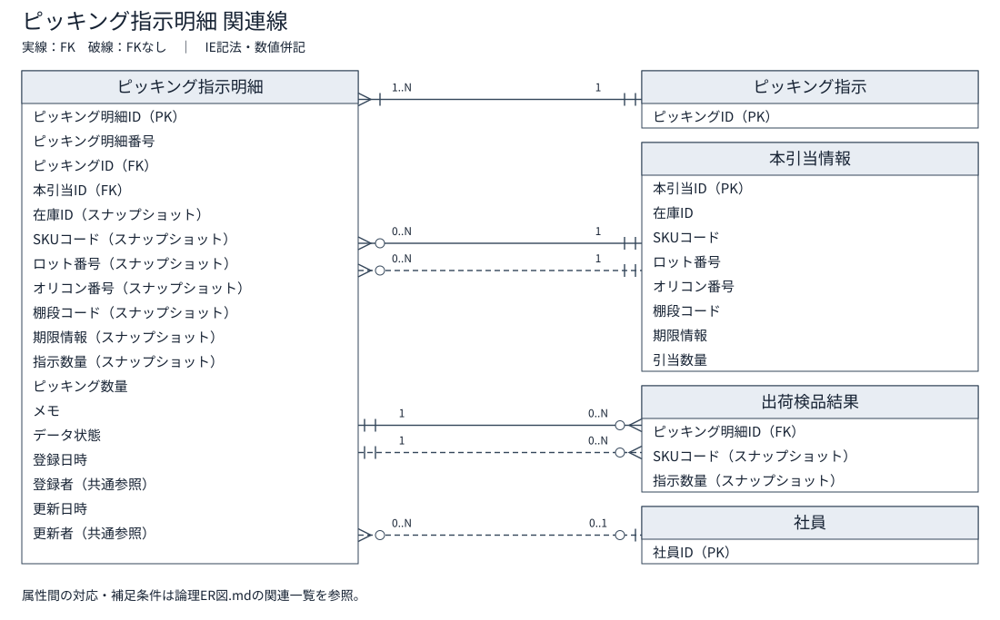

出荷検品結果

| テーブル | 関連キー | 多重度 | 関連元テーブル | 関連キー | 多重度 |
| --- | --- | :---: | --- | --- | :---: |
| 出荷検品結果 | ピッキング明細ID（FK） | 0..N | ピッキング指示明細 | ピッキング明細ID（PK） | 1 |
| 出荷検品結果 | SKUコード（スナップショット） | 0..N | ピッキング指示明細 | SKUコード | 1 |
| 出荷検品結果 | 指示数量（スナップショット） | 0..N | ピッキング指示明細 | 指示数量 | 1 |
| 出荷検品結果 | 登録者（共通参照） | 0..N | 社員 | 社員ID（PK） | 0..1 |
| 出荷検品結果 | 更新者（共通参照） | 0..N | 社員 | 社員ID（PK） | 0..1 |

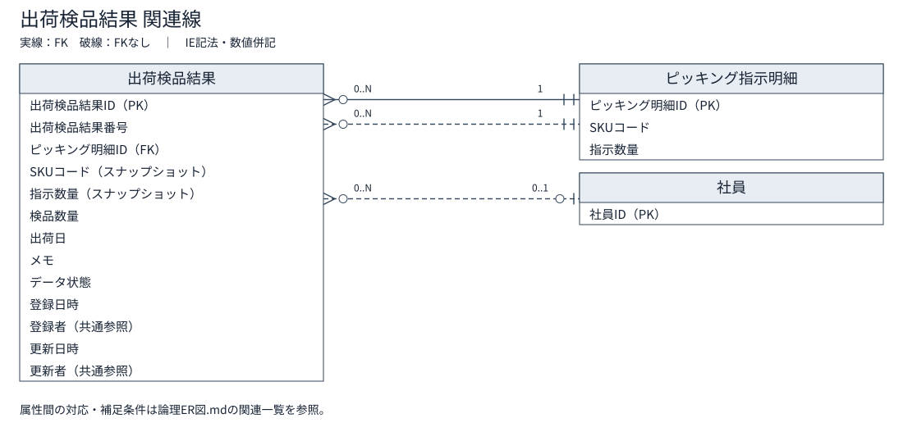

CSV取込結果

| テーブル | 関連キー | 多重度 | 関連元テーブル | 関連キー | 多重度 |
| --- | --- | :---: | --- | --- | :---: |
| CSV取込結果 | CSV取込結果ID（PK） | 0..1 | 入荷予定 | CSV取込結果ID（ID保持） | 0..N |
| CSV取込結果 | CSV取込結果ID（PK） | 0..1 | 出荷 | CSV取込結果ID（ID保持） | 0..N |
| CSV取込結果 | 会社コード（スナップショット） | 0..N | 会社 | 会社コード | 1 |
| CSV取込結果 | 登録者（共通参照） | 0..N | 社員 | 社員ID（PK） | 0..1 |

### 3.1 多重度の補足条件

| 関連 | 補足条件 |
| --- | --- |
| 棚段・オリコン | 棚段の格納上限および在庫の有無による割当条件に従う |
| 会社・読み取り設定・CSV取込設定 | 同一会社・同一読み取り種別の有効な設定は最大1件 |
| 入荷予定・入荷予定明細 | 明細が1件以上必要 |
| 入荷実績・入庫実績 | 分割入庫を許容する |
| SKU・ロット・在庫 | 在庫とロットのSKUIDを一致させる |
| 出荷・出荷明細 | 明細が1件以上必要 |
| ピッキング指示・ピッキング指示明細 | 明細が1件以上必要 |
| 本引当情報・ピッキング指示明細 | 論理削除されていない明細は最大1件 |
| ピッキング指示明細・出荷検品結果 | 有効な検品結果は最大1件 |
