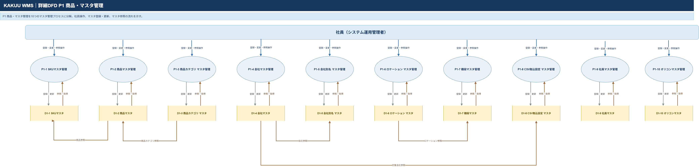
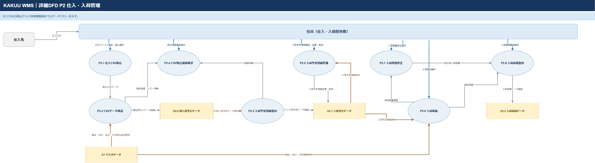
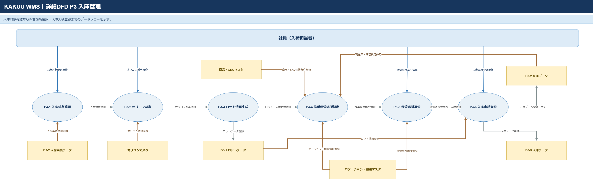
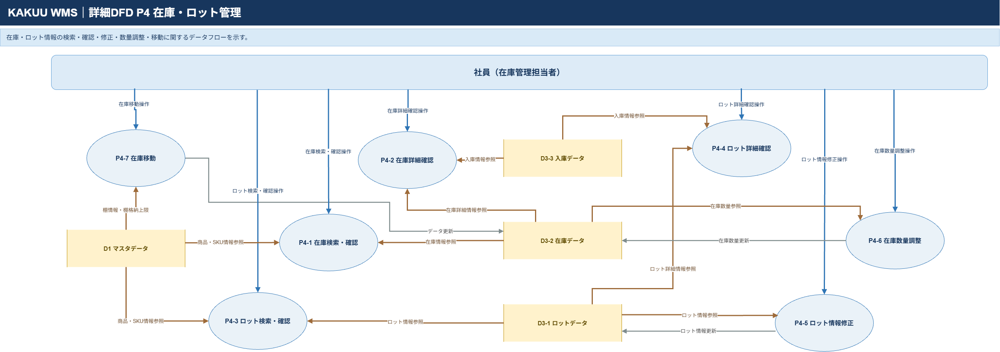
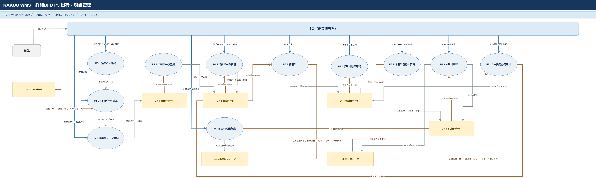
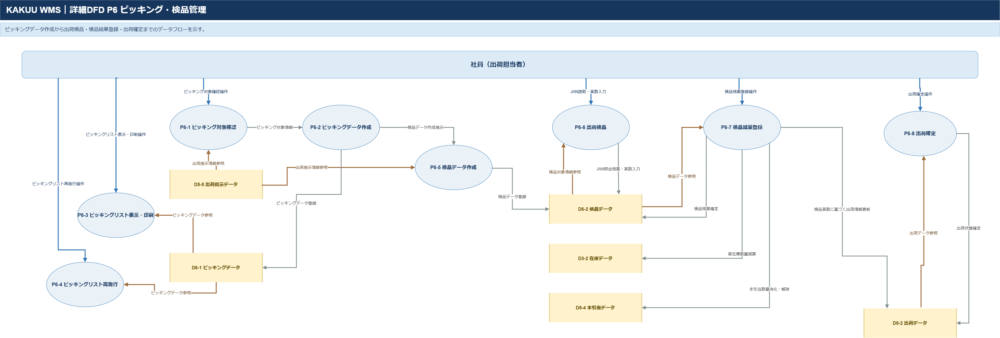
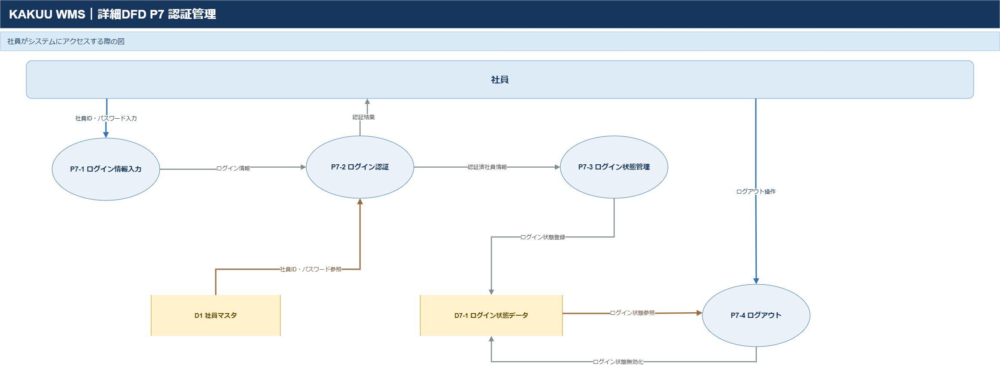

# 詳細DFD

上位DFDの主要プロセスP1～P7について、詳細DFDをプロセス番号順に掲載する。

## P1 商品・マスタ管理

[編集元（draw.io）](source/詳細WMS_DFD_P1.drawio)

## P2 仕入・入荷管理

[編集元（draw.io）](source/詳細WMS_DFD_P2.drawio)

## P3 入庫管理

[編集元（draw.io）](source/詳細WMS_DFD_P3.drawio)

## P4 在庫・ロット管理

[編集元（draw.io）](source/詳細WMS_DFD_P4.drawio)

## P5 出荷・引当管理

[編集元（draw.io）](source/詳細WMS_DFD_P5.drawio)

## P6 ピッキング・検品管理

[編集元（draw.io）](source/詳細WMS_DFD_P6.drawio)

## P7 認証管理

[編集元（draw.io）](source/詳細WMS_DFD_P7.drawio)

